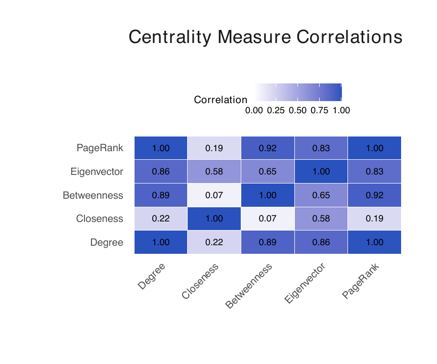
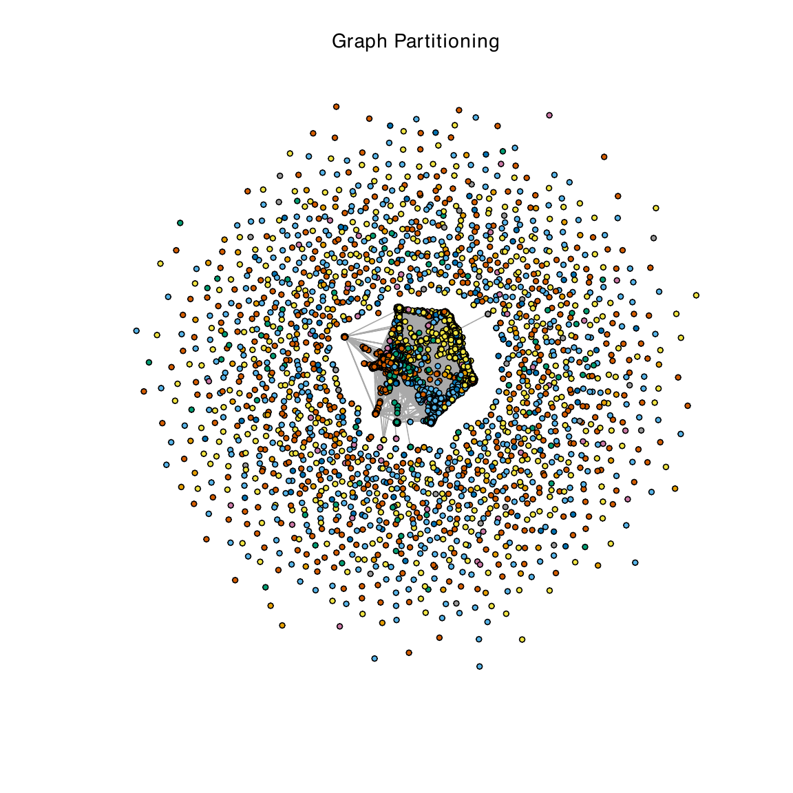

```{r setup}
#| include: false

library(igraph)
library(readr)
library(dplyr)
library(tidyr)
library(ggplot2)
library(knitr)
library(scales)

set.seed(42)

web_color <- "#2563EB"
ml_color  <- "#E11D48"
ink_color <- "#172033"

theme_set(
  theme_minimal(base_size = 13) +
    theme(
      plot.title = element_text(face = "bold", color = ink_color),
      plot.subtitle = element_text(color = "#596579"),
      panel.grid.minor = element_blank(),
      legend.position = "top"
    )
)

options(knitr.kable.NA = "")
```

# Abstract {.unnumbered}

This project analyzes the GitHub social network distributed with the MUSAE project. The data contain 37,700 developers and 289,003 undirected edges representing mutual-follower relationships. Each developer is labeled as either a Web Developer or a Machine Learning Engineer based on the developer's job title. The analysis examines graph connectivity, hubs, degree distributions, centrality, communities, assortativity, random-graph comparisons, and small-world structure.

# Introduction

## Motivation and importance

GitHub is a major platform for hosting and sharing open-source software [@hague2022globalgithub]. A public GitHub profile can function as a portfolio, while follower relationships provide a useful lens for studying visibility, influence, and the organization of the software-development community.

## Prior work

The data were released as part of the MUSAE project and are hosted by the [Stanford Network Analysis Project](https://snap.stanford.edu/data/github-social.html). MUSAE is an attributed node-embedding method designed for node-classification tasks [@rozemberczki2021musae]. This report applies classical graph-analysis methods to the same developer network, following the workflow described by @kolaczyk2020sand.

## Limitations

The network is a snapshot collected in June 2019, so it does not represent the present-day developer ecosystem. Its binary job-title label omits many occupations, and mutual followers capture only one form of interaction: shared repositories, commits, reviews, issues, and other collaborative activity are absent. The inclusion rule also favors visible developers, because every developer in the source data had starred at least ten repositories.

# Data

## Source and construction

The structural and attribute data are stored separately:

- `musae_git_edges.csv` contains the undirected edge list.
- `musae_git_target.csv` contains numeric node IDs, usernames, and the binary `ml_target` label.

```{r load-and-construct}
# Load the two source files.
edges <- read_csv("musae_git_edges.csv", show_col_types = FALSE)
developers <- read_csv("musae_git_target.csv", show_col_types = FALSE)

# igraph expects the vertex key in a column named `name`. Preserve the
# human-readable GitHub username in a separate `developer` attribute.
vertices <- developers |>
  rename(developer = name) |>
  transmute(
    name = as.character(id),
    developer,
    ml_target = as.integer(ml_target)
  )

github_graph <- graph_from_data_frame(
  edges,
  directed = FALSE,
  vertices = vertices
) |>
  simplify(remove.multiple = TRUE, remove.loops = TRUE)

degree_all <- degree(github_graph)
component_info <- components(github_graph)
core_number <- coreness(github_graph)
```

## Validation and overview

```{r graph-overview}
overview <- tibble(
  Nodes = vcount(github_graph),
  Edges = ecount(github_graph),
  Density = edge_density(github_graph),
  Components = component_info$no,
  Simple = is_simple(github_graph),
  Directed = is_directed(github_graph),
  `Maximum k-core` = max(core_number)
)

kable(
  overview,
  digits = 6,
  caption = "Observed properties of the GitHub mutual-follower network."
)
```

The graph is simple, undirected, globally connected, and sparse. Its density is only about $4.07 \times 10^{-4}$, even though all 37,700 developers belong to one connected component.

```{r label-balance}
label_balance <- developers |>
  count(ml_target, name = "Count") |>
  mutate(
    Label = if_else(ml_target == 0, "Web (0)", "MLE (1)"),
    Percent = percent(Count / sum(Count), accuracy = 0.1)
  ) |>
  select(Label, Count, Percent)

kable(label_balance, caption = "Distribution of developer-type labels.")
```

Web Developers account for 74.2% of the nodes, while Machine Learning Engineers account for 25.8%. This is a node attribute on an ordinary graph, not a bipartite structure: both kinds of developers can connect to either kind.

# Methods and analysis

All graph operations use the R `igraph` package [@csardi2006igraph]. The analysis code is displayed in full throughout the page with line numbers and copy controls.

## Top hub nodes

```{r top-hubs}
top_hubs <- tibble(
  `Node ID` = as.integer(V(github_graph)$name),
  Developer = V(github_graph)$developer,
  Degree = degree_all,
  Label = if_else(V(github_graph)$ml_target == 0, "Web", "MLE")
) |>
  arrange(desc(Degree)) |>
  slice_head(n = 15) |>
  mutate(Rank = row_number(), .before = 1)

kable(top_hubs, format.args = list(big.mark = ","),
      caption = "Top 15 developers by mutual-follower degree.")
```

The highest-degree nodes are all labeled Web Developers. The concentration around developers such as `addyosmani`, `getify`, `mdo`, `jeresig`, and `mbostock` is consistent with the visibility of web tooling and education in the 2019 GitHub ecosystem.

## Degree distribution

```{r degree-summary}
degree_summary <- tibble(
  Statistic = c("Minimum", "First quartile", "Median", "Mean",
                "Third quartile", "90th percentile", "99th percentile", "Maximum"),
  Degree = c(
    min(degree_all),
    quantile(degree_all, 0.25),
    median(degree_all),
    mean(degree_all),
    quantile(degree_all, 0.75),
    quantile(degree_all, 0.90),
    quantile(degree_all, 0.99),
    max(degree_all)
  )
)

kable(degree_summary, digits = 2, caption = "Degree-distribution summary.")
```

The median degree is 6, whereas the mean is 15.33 and the maximum is 9,458. The large gap between the center and the upper tail reveals a strongly right-skewed network dominated by a small set of hubs.

```{r degree-plots}
#| fig-cap: "Degree distribution on linear and logarithmic scales. The linear panel shows the concentration of low-degree nodes; the log-log complementary cumulative distribution shows the long upper tail."
#| fig-width: 10
#| fig-height: 4.2
#| layout-ncol: 2

degree_plot_data <- tibble(degree = degree_all)

ggplot(degree_plot_data, aes(degree)) +
  geom_histogram(binwidth = 5, boundary = 0, fill = web_color, color = "white") +
  coord_cartesian(xlim = c(0, 250)) +
  labs(title = "Linear degree histogram", x = "Degree", y = "Developers")

degree_ccdf <- degree_plot_data |>
  count(degree, name = "frequency") |>
  arrange(degree) |>
  mutate(ccdf = rev(cumsum(rev(frequency))) / sum(frequency))

ggplot(degree_ccdf, aes(degree, ccdf)) +
  geom_point(size = 1.2, alpha = 0.7, color = web_color) +
  scale_x_log10(labels = label_number(big.mark = ",")) +
  scale_y_log10() +
  labs(title = "Log-log degree CCDF", x = "Degree", y = "P(Degree ≥ x)")
```

The upper tail is compatible with a heavy-tailed or preferential-attachment process. A straight-looking region in a log-log plot is suggestive, but it is not by itself sufficient evidence that the data follow an exact power law.

## Vertex centrality

Centrality measures describe different kinds of structural importance. Degree captures immediate reach; betweenness identifies bridges; closeness captures network-wide reachability; and eigenvector centrality rewards connections to other well-connected nodes.

```{r centrality-code}
#| eval: false

# Exact full-network centralities are intentionally not recalculated during
# every website build. Enable this chunk to reproduce them; it can take several
# minutes depending on the igraph version and build machine.
centrality <- tibble(
  degree = degree(github_graph, normalized = TRUE),
  betweenness = betweenness(github_graph, normalized = TRUE),
  closeness = closeness(github_graph, normalized = TRUE),
  eigenvector = eigen_centrality(github_graph)$vector
)

summary(centrality)
cor(centrality, use = "complete.obs")
```

```{r centrality-summary}
centrality_summary <- tribble(
  ~Statistic, ~Degree, ~Betweenness, ~Closeness, ~Eigenvector,
  "Minimum",       0.00002653, 0.000000001, 0.1414, 0.0000000,
  "First quartile",0.00005305, 0.000000045, 0.2841, 0.0004698,
  "Median",        0.0001592,  0.000001529, 0.3113, 0.0030462,
  "Mean",          0.0004067,  0.000059592, 0.3137, 0.0066687,
  "Third quartile",0.0003448,  0.000017282, 0.3469, 0.0089577,
  "Maximum",       0.2509689,  0.269626963, 0.5231, 1.0000000
)

kable(centrality_summary, digits = 8,
      caption = "Summary statistics reported for full-network centrality measures.")
```

{#fig-centrality-correlation width=75% fig-align="center"}

Degree and eigenvector centrality are extremely concentrated: a small group of developers is both highly connected and connected to other influential developers. Betweenness is also heavily concentrated, identifying a limited set of bridge-like nodes. Closeness varies less dramatically, which is consistent with short paths in the connected graph. The correlation plot shows that betweenness contains comparatively distinct information.

## Components, transitivity, and clustering

```{r cohesion}
cohesion <- tibble(
  Components = component_info$no,
  Nodes = vcount(github_graph),
  Edges = ecount(github_graph),
  `Global transitivity` = transitivity(github_graph, type = "global"),
  `Mean local clustering` = transitivity(github_graph, type = "localaverage")
)

kable(cohesion, digits = 6, format.args = list(big.mark = ","),
      caption = "Connectivity and clustering measures.")
```

The graph consists of a single giant component. Global transitivity is about 0.0124, while mean local clustering is about 0.1934. The difference indicates that many local neighborhoods contain triangles even though the global network remains dominated by connections through hubs.

```{r local-clustering}
#| fig-cap: "Distribution of non-missing local clustering coefficients."
#| fig-width: 8
#| fig-height: 4.5

local_clustering <- transitivity(github_graph, type = "local", isolates = "NaN")

tibble(clustering = local_clustering[is.finite(local_clustering)]) |>
  ggplot(aes(clustering)) +
  geom_histogram(bins = 50, fill = web_color, color = "white") +
  labs(x = "Local clustering coefficient", y = "Developers",
       title = "Local clustering is concentrated near zero")
```

## Community detection and graph partitioning

Fast-greedy community detection iteratively joins groups to maximize modularity. Because the precise optimum can change across `igraph` versions, the original report's cached run is retained for the published result.

```{r fast-greedy-code}
#| eval: false

# This full-network calculation is available for an exact rerun. It is disabled
# in routine Netlify builds because it is version-sensitive and comparatively
# expensive (roughly tens of seconds on a modern laptop).
fast_greedy_fit <- cluster_fast_greedy(github_graph)

tibble(
  Communities = length(fast_greedy_fit),
  Modularity = modularity(fast_greedy_fit)
)

sort(sizes(fast_greedy_fit), decreasing = TRUE) |> head(10)
```

```{r reported-community-result}
community_result <- tibble(
  Algorithm = "Fast-greedy",
  Communities = 335,
  Modularity = 0.3957
)

kable(community_result, digits = 4,
      caption = "Community-detection result retained from the original report run.")
```

{#fig-graph-partition width=78% fig-align="center"}

The moderate modularity indicates meaningful community structure, with a prominent central region and many peripheral groups.

```{r kcore-plot}
#| fig-cap: "Number of developers assigned to each k-core."
#| fig-width: 8
#| fig-height: 4.5

core_distribution <- tibble(core = core_number) |>
  count(core, name = "developers")

ggplot(core_distribution, aes(core, developers)) +
  geom_col(fill = web_color) +
  scale_y_continuous(labels = label_comma()) +
  labs(x = "Core number", y = "Developers", title = "K-core distribution")
```

The maximum core number is 34. High-core developers form a densely connected nucleus, while the lower cores contain the much larger periphery.

## Assortativity and mixing patterns

Assortativity measures whether similar nodes preferentially connect. We examine both degree mixing and professional homophily.

```{r assortativity}
degree_assortativity <- assortativity_degree(github_graph, directed = FALSE)
type_assortativity <- assortativity_nominal(
  github_graph,
  # igraph's nominal assortativity implementation expects positive integer
  # category codes, so map the stored 0/1 labels to 1/2.
  types = V(github_graph)$ml_target + 1L,
  directed = FALSE
)

assortativity_table <- tibble(
  Measure = c("Degree", "Job type (homophily)"),
  Value = c(degree_assortativity, type_assortativity),
  Interpretation = c(
    "Mildly disassortative: hubs connect to the periphery",
    "Strongly assortative: the same developer types connect"
  )
)

kable(assortativity_table, digits = 3,
      caption = "Assortativity coefficients.")
```

The degree coefficient of about $-0.075$ supports a hub-and-spoke interpretation. The job-type coefficient of about $0.378$ indicates substantial homophily.

```{r mixing-matrix}
edge_ends <- ends(github_graph, E(github_graph), names = FALSE)
edge_labels <- tibble(
  from = V(github_graph)$ml_target[edge_ends[, 1]],
  to   = V(github_graph)$ml_target[edge_ends[, 2]]
) |>
  mutate(
    pair = case_when(
      from == 0 & to == 0 ~ "Web-Web",
      from == 1 & to == 1 ~ "MLE-MLE",
      TRUE ~ "Web-MLE"
    )
  ) |>
  count(pair, name = "Observed edges")

n_web <- sum(V(github_graph)$ml_target == 0)
n_mle <- sum(V(github_graph)$ml_target == 1)

mixing_probabilities <- tibble(
  pair = c("Web-Web", "Web-MLE", "MLE-MLE"),
  `Possible pairs` = c(choose(n_web, 2), n_web * n_mle, choose(n_mle, 2))
) |>
  left_join(edge_labels, by = "pair") |>
  mutate(`Edge probability` = `Observed edges` / `Possible pairs`) |>
  rename(`Block pair` = pair)

kable(mixing_probabilities, digits = 7, format.args = list(big.mark = ","),
      caption = "Observed edges and possible-pair-adjusted block probabilities.")
```

After controlling for group size, both within-group edge probabilities remain much larger than the Web-MLE probability. Professional homophily is therefore not merely an artifact of the 3:1 class imbalance.

## Comparison with random graph models

Random graphs provide controlled null models. Erdős-Rényi preserves the observed density in expectation; the configuration model preserves the degree sequence; Watts-Strogatz emphasizes local clustering and short paths; and Barabási-Albert generates hubs through preferential attachment.

```{r random-model-code}
#| eval: false

# The original analysis generated each null model at the observed network size.
# This code is kept visible but disabled for fast, reliable web builds.
n <- vcount(github_graph)
m <- ecount(github_graph)
p <- 2 * m / (n * (n - 1))
mean_degree <- mean(degree(github_graph))

er_graph <- sample_gnp(n, p)
configuration_graph <- sample_degseq(degree(github_graph), method = "vl")
watts_strogatz_graph <- sample_smallworld(
  dim = 1, size = n, nei = floor(mean_degree / 2), p = 0.05
)
barabasi_albert_graph <- sample_pa(n, m = round(mean_degree / 2), directed = FALSE)
```

```{r model-comparison}
model_comparison <- tribble(
  ~Model, ~Nodes, ~`Mean degree`, ~`SD degree`, ~Transitivity, ~`Average path`,
  "GitHub network",       37700, 15.33, 80.79, 0.0124, 3.24,
  "Erdős-Rényi",         37700, 15.33,  3.92, 0.0004, 4.14,
  "Configuration model", 37700, 15.33, 80.79, 0.0169, 3.34,
  "Watts-Strogatz",      37700, 14.00,  1.17, 0.5052, 4.25,
  "Barabási-Albert",       37700, 16.00, 19.88, 0.0027, 3.65
)

kable(model_comparison, digits = 4, format.args = list(big.mark = ","),
      caption = "Network properties compared with classical random-graph models.")
```

The configuration model comes closest on degree variability and path length, showing how much of the observed structure is explained by the degree sequence. Erdős-Rényi substantially understates clustering, Watts-Strogatz overstates it for these parameters, and the Barabási-Albert model produces hubs but not the full observed degree variability.

## Small-world assessment

A network has small-world structure when clustering is much higher than in a comparable random graph while typical path lengths remain similar [@watts1998smallworld]. The usual score is

$$
\sigma = \frac{C_{\text{obs}}/C_{\text{ER}}}{L_{\text{obs}}/L_{\text{ER}}}.
$$

```{r small-world-score}
observed_clustering <- 0.0124
er_clustering <- 0.000409
observed_path <- 3.24
er_path <- 4.13

clustering_ratio <- observed_clustering / er_clustering
path_ratio <- observed_path / er_path
small_world_sigma <- clustering_ratio / path_ratio

small_world <- tibble(
  Property = c("Clustering coefficient", "Average path length"),
  GitHub = c(observed_clustering, observed_path),
  `ER mean` = c(er_clustering, er_path),
  Ratio = c(clustering_ratio, path_ratio)
)

kable(small_world, digits = 3,
      caption = "Observed network compared with an Erdős-Rényi baseline.")

cat("Small-world score (sigma):", round(small_world_sigma, 1))
```

The score is approximately $38.7$, far above 1. Developers are separated by only three to four intermediaries on average, while local clustering is roughly 30 times the Erdős-Rényi baseline.

# Results

The GitHub network is simple, undirected, connected, and sparse. Its degree distribution is highly skewed: most developers have few mutual-follower connections, while a small elite of hubs dominates reach and influence. The network exhibits small-world structure, mild negative degree assortativity, and strong professional homophily. A moderately modular community structure and a maximum 34-core further reveal a dense nucleus surrounded by a much larger periphery.

# Discussion

The results point to a visibility hierarchy. Established developers attract connections from the wider periphery, a pattern compatible with preferential attachment. Bridge-like nodes and high-degree hubs can act as gatekeepers, although an articulation point should not be interpreted as proof that removing a single famous hub would fragment the entire global community in a practically meaningful way. Professional homophily may also limit contact across developer specialties, but the binary Web/MLE label is too coarse to establish the existence of echo chambers by itself.

# Future work

Future analysis should use newer and longitudinal data, especially given the rapid growth of machine learning and generative AI. Richer occupation and activity attributes would provide a more realistic account of developer identity and collaboration. Link prediction could model network growth, while exponential random graph models or scalable latent-space models could test higher-order mechanisms such as triadic closure and attribute homophily.

# References {.unnumbered}
