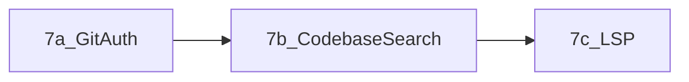

# Remote workspace WebSocket protocol (Treena)

Single JSON-per-frame WebSocket between the app and the **workspace bridge** (`server/server.mjs` today). Paths in FS messages are **posix-relative** to the workspace root; `..` and path escape are rejected server-side.

**Version:** v0 (implemented) + planned extensions (v1). Increment `proto` in `hello` when you add breaking changes.

---

## Implemented (v0)

### Terminal (PTY)

| Direction | `t` | Payload |
|-----------|-----|---------|
| C→S | `in` | `d`: string (raw bytes to shell, include `\n` for Enter) |
| C→S | `resize` | `cols`, `rows` (positive integers) |
| S→C | `out` | `d`: string (PTY output chunk) |
| S→C | `err` | `m`: string (e.g. spawn failure) |

### Filesystem RPC

Every request includes a numeric **`id`** (correlate with response). Response shape: `{ "t": "fs.resp", "id", ... }`.

| C→S `t` | Fields | S→C on success | S→C on failure |
|---------|--------|----------------|----------------|
| `fs.list` | `path` (rel), `maxDepth?` | `ok: true`, `tree` (nested `{ name, relPath, isDirectory, children? }`) | `ok: false`, `err` |
| `fs.read` | `path` | `ok: true`, `content` (utf-8) | `ok: false`, `err` |
| `fs.write` | `path`, `content` | `ok: true` | `ok: false`, `err` |
| `fs.mkdir` | `path` | `ok: true` (recursive) | `ok: false`, `err` |
| `fs.rm` | `path` | `ok: true` (file or recursive dir) | `ok: false`, `err` |
| `fs.rename` | `from`, `to` | `ok: true` | `ok: false`, `err` |

**Suggested `err` strings (machine-parsable prefix optional):** `ENOENT`, `EACCES`, `EINVAL`, `OUTSIDE_WORKSPACE`, `TIMEOUT` (client-only).

---

## Phase 3 (implemented) — file watcher → phone

Server pushes (no `id`):

```json
{ "t": "fs.event", "kind": "add"|"change"|"unlink", "path": "rel/path", "oldPath": "optional" }
```

Server debounces ~200ms and ignores `node_modules` / `.git`. Client debounces tree **refresh** (~300ms), **reloads** the open remote file on `change` when `editBuffer === currentFileContent`, otherwise sets agent status to warn about conflict. **unlink** of the open file (or a parent path) **closes** the editor tab (`clearCurrentFile`).

Optional later: content **hash** + diff card when remote changes under dirty buffer.

---

## Phase 4 (implemented) — remote agent tools

Same WebSocket; **`id` is a string** (distinct from numeric `fs.resp`).

**Client → server:**

```json
{ "t": "agent.tool", "id": "<string>", "name": "<tool>", "args": { } }
```

**Server → client:**

```json
{ "t": "agent.tool_result", "id": "<same>", "ok": true, "result": { } }
{ "t": "agent.tool_result", "id": "<same>", "ok": false, "err": "...", "code": "E_TOOL" }
```

**Tools (v1):**

| `name` | Notes |
|--------|--------|
| `read_file` | UTF-8; max **512 KiB** |
| `write_file` | Max **512 KiB** content; use for full create/replace |
| `apply_patch` | Targeted text replacements in an existing file using ordered `hunks` (`oldText` → `newText`, optional `replaceAll`) |
| `list_dir` | One level under `path` (`""` = root) |
| `grep` | `rg` if installed, else `grep -R`; **256 KiB** cap; excludes `node_modules` / `.git` |
| `run_command` | **Allowlist:** `npm`, `npx`, `node`, `git`, `ls`, `cat`, `echo`, `pwd`. Default: **60s** timeout; **256 KiB** stdout/stderr each. Optional **`background: true`**: detached spawn, returns immediately with **`pid`** (max **3** concurrent background spawns per WebSocket); processes receive **SIGTERM** when the socket closes |
| `start_server` | Background process; same allowlist as `run_command`; requires `port`; polls for readiness (15s); max **2** per session |
| `browse_url` | Returns URL; client opens in-app browser tab. **`http://localhost:PORT`** rewritten to **`http://<workspace-host>:PORT/...`** (direct port on the task/bridge machine so asset paths resolve) |

**App:** [hooks/useAgent.ts](../hooks/useAgent.ts) uses streaming tool completions when remote workspace is on; loops until no `tool_calls` or **200** rounds. After successful `write_file` and `apply_patch`, the client calls **`refreshFileTree`**. **Local mode** unchanged (stream + 4k open-file slice). Tool rows in chat can render diffs for both full writes and patch applies.

---

## Phase 5 (implemented) — Git RPC in container

Same WebSocket as FS/PTY; **`id` is numeric** (like `fs.resp`). Response: `{ "t": "git.resp", "id", ... }`.

**Client → server:**

| C→S `t` | Fields | Notes |
|---------|--------|--------|
| `git.status` | — | `cwd` is server workspace root |
| `git.log` | `depth?` (1–100, default 20) | |
| `git.commit` | `message`, `authorName?`, `authorEmail?` | runs `git add -A` then `git commit` |
| `git.checkout` | `branch` | checks out local branch, creating with `checkout -b` if missing |
| `git.pull` | `token?` (optional PAT) | HTTPS: `http.extraHeader` Basic; **120s** server timeout |
| `git.push` | `token?`, `setUpstream?`, `branch?` | push; with `setUpstream` + `branch`, runs `git push -u origin <branch>` |
| `git.remote_list` | — | `ok: true`, `remotes`: `[{ name, fetchUrl }]` from `git remote -v` |

**Server → client (`git.resp`):**

| Success | Payload |
|---------|---------|
| `git.status` | `ok: true`, `branch`, `lines` (stdout lines of `git status --porcelain=1`; client maps to file badges) |
| `git.log` | `ok: true`, `entries`: `{ oid, message, author, timestamp }[]` (ms) |
| `git.commit` | `ok: true`, `oid?` (short from stderr), `output?` |
| `git.checkout` | `ok: true` |
| `git.pull` / `git.push` | `ok: true` |

On failure: `ok: false`, `err` (e.g. `not a git repository` for status in a non-repo).

**Security / product:** The optional `token` is sent on the WebSocket in plaintext (acceptable for dev/LAN; do not use over untrusted networks without TLS and a stronger auth story). **`git clone` / `git.init`** are not RPC’d; use the terminal or initialize the bind-mounted repo on the host.

**App:** [hooks/useGit.ts](../hooks/useGit.ts) uses these RPCs when `projectRoot` is remote; local repos still use isomorphic-git.

---

## Phase 6 — Hardening (implemented slices)

### Session handshake (always)

After **`BRIDGE_TOKEN`** succeeds (if set), the bridge attaches the PTY + RPC handler, then sends in order:

1. **`session.ok`** — `{ "t": "session.ok", "workspaceId": "<string>", "rootFileUri": "<file:// workspace root>" }`  
   - `workspaceId` is empty when JWT is not in use; otherwise the claim value.  
   - `rootFileUri` lets the client build `file:` URIs for LSP.
2. **`out`** — connected banner (PTY).

If authentication fails before the session is established, the server may send **`session.err`**:  
`{ "t": "session.err", "code": "JWT_EXPIRED" | "JWT_INVALID" | "AUTH_TIMEOUT" | …, "m": "<message>" }` and close the socket.

The app waits for **`session.ok`** before sending FS / git / workspace / agent / LSP traffic (except **`session.auth`**, see below).

### Auth (shared secret)

If the server sets **`BRIDGE_TOKEN`**, every WebSocket client must use query param **`token`** (constant-time compare). The app appends it via `buildRemoteWorkspaceWsUrl`. **Defense in depth:** when **`JWT_SECRET`** (or **`BRIDGE_JWT_SECRET`**) is also set, both **`BRIDGE_TOKEN`** and a valid JWT are required.

### Auth (JWT, HS256)

Env: **`JWT_SECRET`** or **`BRIDGE_JWT_SECRET`**, optional **`JWT_ISS`**, **`JWT_AUD`**, optional **`WORKSPACE_ID`** (claim `workspaceId` must match when set).

- **Query:** `?jwt=<token>` on the WebSocket URL, or  
- **First client message:** `{ "t": "session.auth", "jwt": "<token>" }` within **15s** (if `jwt` is not in the query).

Claims (payload): **`workspaceId`** (string, required), **`exp`** (required), optional **`sub`**, **`iss`**, **`aud`**.

### Rate limits & frames

- Max inbound frame size **2 MiB** (oversize → drop / auth error in pre-auth phase).
- Per-connection message rate: **80** messages / second (sliding window).
- Optional per-IP rate: **200** messages / second when **`TRUST_PROXY=1`** and **`X-Forwarded-For`** is trusted.
- Concurrent caps: **`run_command`** (foreground) **3**, **`run_command`** (`background: true`) **3**, **`grep`** (tool + shared with `workspace.search`) **2**, **`workspace.search` / `diagnostics.file` combined** **2**.
- Throttle response: `{ "t": "err", "m": "…", "code": "RATE_LIMIT" }`.

### Audit & redaction

Structured **`audit`** lines on stdout (JSON, one per line): `ts`, `event`, `workspaceId`, minimal fields — **no** PAT/JWT bodies. `console.error` paths use **`safeLog`** redaction (Bearer, `token=`, `ghp_`, JWT-shaped strings).

### Infra (quotas / egress)

Documented in [server/README.md](../server/README.md) (Docker **`--cpus`**, **`--memory`**, volume sizing, egress patterns). Bridge may add soft disk checks later.

---

## Phase 6b — LSP multiplex (JSON-RPC over WebSocket)

After **`session.ok`**, client may send:

```json
{ "t": "lsp.req", "id": <number>, "method": "textDocument/definition", "params": { } }
```

Server → client:

```json
{ "t": "lsp.resp", "id": <same>, "ok": true, "result": { } }
{ "t": "lsp.resp", "id": <same>, "ok": false, "err": "…" }
```

The bridge spawns **`typescript-language-server --stdio`** from **`server/node_modules`** (workspace `cwd` = `WORKSPACE_DIR`). The app uses **`textDocument/didOpen`** + **`textDocument/definition`** for remote `.ts`/`.tsx`/`.js`/`.jsx` (unsaved buffer in `didOpen`).

---

## Phase 6c — Git remote list

| C→S `t` | Fields | S→C (`git.resp`) |
|---------|--------|------------------|
| `git.remote_list` | — | `ok: true`, `remotes`: `[{ "name", "fetchUrl" }]` |

Used client-side to pick a PAT keyed by normalized fetch URL for **`git.pull` / `git.push`**.

---

## Phase 6d — Semantic search (placeholder)

| C→S `t` | Notes |
|---------|--------|
| `workspace.embed_search` | Returns `ok: false`, `err`: **`NOT_IMPLEMENTED`**. Optional pipeline TBD — see [semantic-search-future.md](semantic-search-future.md). |

---

<a id="phase-7-plus-roadmap"></a>

## Phase 7+ (roadmap; after stable remote session)

**Product slices:** Git auth (per-remote PAT + bridge PAT) → dedicated search UI + `@codebase` → LSP JSON-RPC + `diagnostics.file` + go-to-definition. **Future:** GitHub OAuth, SSH keys in isolated VMs, embedding-based search — see [git-auth-advanced.md](git-auth-advanced.md) and [semantic-search-future.md](semantic-search-future.md).

### Phase 7 — bridge RPC (implemented, v1)

Same WebSocket; numeric **`id`**; response **`{ "t": "workspace.resp", "id", ... }`**.

| C→S `t` | Fields | S→C success |
|---------|--------|--------------|
| `workspace.search` | `pattern`, `path?`, `max_matches?` | `ok: true`, `matches`: `[{ path, line, text }]` (from ripgrep/grep; cap 120) |
| `diagnostics.file` | `path` (rel) | `ok: true`, `diagnostics`: `[{ line, col, severity, message }]` from `npx tsc --noEmit` on that file (45s timeout; requires `typescript` in bridge `node_modules`) |
| `workspace.embed_search` | (reserved) | `NOT_IMPLEMENTED` |

**App:** [hooks/useAgent.ts](../hooks/useAgent.ts) expands **`@codebase`** via [remoteWorkspaceSearch](../lib/workspace/remoteWsBridge.ts). [WorkspaceSearchModal](../components/WorkspaceSearchModal.tsx) calls the same RPC. [hooks/useGit.ts](../hooks/useGit.ts) uses [resolveGithubPatForRemoteGitOps](../lib/gitRemotePat.ts) (PAT by **`git.remote_list`** / `origin` fetch URL, then per-bridge PAT, then global `githubToken`). [CodeViewer](../components/CodeViewer.tsx): remote diagnostics banner + **Go to definition (LSP @ caret)** via [useRemoteGoToDefinition](../hooks/useRemoteGoToDefinition.ts).

### Current codebase (context)

- **Remote agent** **`grep`** tool remains available; **`workspace.search`** adds structured RPC for `@codebase`.
- **Git:** `git.remote_list` + `remoteGithubPatByFetchUrl` + per-bridge PAT + global `githubToken`.
- **Diagnostics:** `diagnostics.file` (`tsc`) + long-lived **typescript-language-server** for `lsp.req` / go-to-def.

### Milestone 7a — Git auth UX

| | |
|--|--|
| **Goal** | Credentials are **workspace-scoped** (local vs `remote:/`), with clear UX for HTTPS PAT and a documented path for SSH later. |
| **In scope (future)** | Per-workspace PAT in Secure Store; settings UI grouped by workspace; server continues to accept `token` on `git.pull` / `git.push` (or evolve to short-lived server-side credential). Document tradeoffs: PAT in RPC message vs env on server. **v1:** PAT per bridge URL in keychain + [SettingsModal](../components/SettingsModal.tsx) Workspace section. |
| **Out of scope (v1)** | Full GitHub OAuth app flow on device; mounting user SSH keys into arbitrary containers without a strong isolation story. |
| **Depends on** | Stable remote session (done); Phase 6 transport token (optional hardening). |
| **Verify (when built)** | User can use token A for repo A and token B for repo B without flipping a single global field. |

### Milestone 7b — @codebase search

| | |
|--|--|
| **Goal** | User-visible **codebase search** (e.g. `@codebase` or a search panel) that runs **in the VM** and returns capped, citeable matches—not only implicit agent `grep` tool use. |
| **In scope (future)** | Reuse **`grep` / `rg`** behind a dedicated RPC (e.g. `workspace.search` with the same caps/sandbox as today) or a thin wrapper; client builds a short context block for the agent and/or shows results in UI; same path rules as `safeFull`. **v1:** `workspace.search` + `@codebase` in agent input. |
| **Out of scope (v1)** | Embeddings / semantic search across the repo. |
| **Depends on** | 7a optional if the bridge is exposed beyond LAN. |
| **Verify (when built)** | From chat or search UI, a query returns paths + line snippets under the workspace root without the model having to invent tool arguments from scratch. |

### Milestone 7c — LSP / diagnostics

| | |
|--|--|
| **Goal** | Errors/warnings (and optionally go-to-definition later) for open files on a **remote** workspace via a server-side language server. |
| **In scope (future)** | Choose transport: multiplex JSON-RPC over the existing WebSocket vs a second channel or port; spawn per-language tooling in the container (e.g. `typescript-language-server`) with resource limits; push `textDocument/publishDiagnostics` to the client; render in [CodeViewer](../components/CodeViewer.tsx) (gutter or side panel). **v1:** `diagnostics.file` + `npx tsc` + banner in CodeViewer for remote TS/TSX on disk. |
| **Out of scope (v1)** | Full IDE parity (rename across files, code actions everywhere, multi-root). |
| **Depends on** | Reliable `fs.read` / `fs.write` + open-file sync (done); 7b optional. |
| **Verify (when built)** | Introduce a TypeScript syntax error in a remote file; a diagnostic appears in the UI within one save/open cycle. |

### Suggested order



### Explicitly not part of current bridge (future)

- Full **GitHub OAuth** device/app flow on device (see [git-auth-advanced.md](git-auth-advanced.md)).
- **SSH** remotes with mounted keys except in a **strong VM isolation** story (see [architecture-full-vm-bridge.md](architecture-full-vm-bridge.md)).
- **Semantic / embedding** search (see [semantic-search-future.md](semantic-search-future.md)).

---

## Remote MVP completion (working definition)

Do not call the remote path “MVP complete” until:

1. Bridge proven: PTY + FS on one connection with safe paths.
2. At least **one real write path from the agent** updates the remote tree and the **phone reflects it** (tree + open file or explicit refresh).

---

## References in repo

- **Phase 7+ roadmap:** this document, section [Phase 7+ (roadmap)](#phase-7-plus-roadmap) above.
- Bridge implementation: [server/server.mjs](../server/server.mjs)
- Client bridge: [lib/workspace/remoteWsBridge.ts](../lib/workspace/remoteWsBridge.ts)
- Virtual paths: [lib/workspace/remotePaths.ts](../lib/workspace/remotePaths.ts)
- Agent (local stream + remote tool loop): [hooks/useAgent.ts](../hooks/useAgent.ts)
- OpenRouter tools API: [lib/openrouterTools.ts](../lib/openrouterTools.ts)
- Per-bridge Git PAT: [lib/gitRemotePat.ts](../lib/gitRemotePat.ts), [lib/workspace/bridgeIdentity.ts](../lib/workspace/bridgeIdentity.ts)
